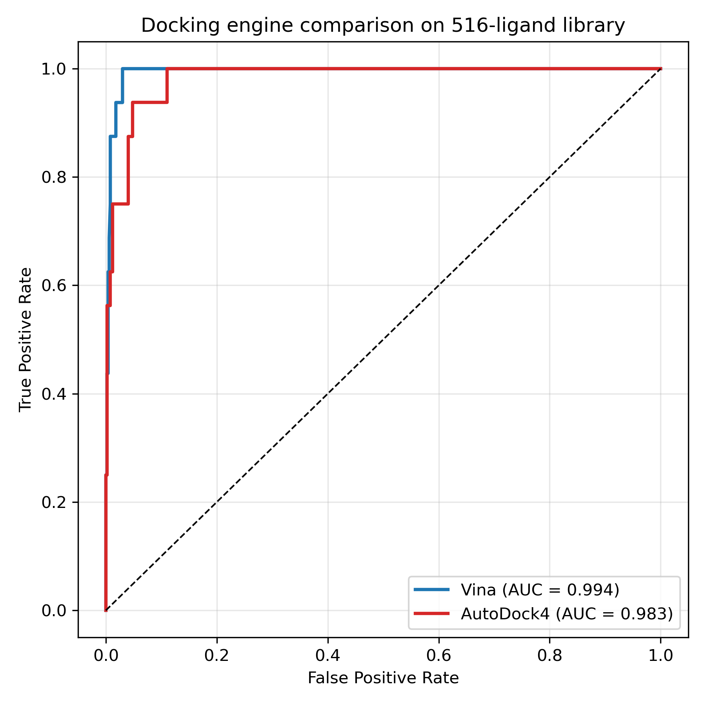

# EGFR Allosteric Inhibitor Discovery

**A docking and interaction-fingerprinting pipeline for allosteric inhibitor discovery against drug-resistant EGFR T790M, with MM/GBSA validation on 1 ns ensembles.**

---

## Motivation

Third-generation EGFR inhibitors like osimertinib work against the T790M gatekeeper mutation until the C797S mutation emerges. At that point every approved ATP-competitive inhibitor fails, because the resistance mechanism directly disrupts the ATP-site binding geometry. Allosteric inhibition — targeting the pocket between the αC-helix and the ATP cleft — offers a route around this problem because allosteric binding does not depend on the ATP site.

The computational difficulty is that allosteric pockets are more plastic than ATP sites, and docking scoring functions are worse at discriminating true binders from geometrically compatible decoys in flexible pockets. This project tests whether a docking pipeline can be validated against known biology, and whether MM/GBSA on short-but-real MD ensembles can rescue the false positives that docking alone would promote.

The starting structure is the crystal structure of T790M/V948R EGFR bound to the allosteric inhibitor EAI045 (PDB 5D41). The compound library is 16 literature-validated allosteric EGFR inhibitors plus 500 drug-like decoys generated with RDKit. The pipeline docks all 516 compounds against the allosteric pocket, benchmarks the protocol against the actives/decoys split, carries the top 4 hits through MD, and analyses interaction geometry.

---

## Key Findings

### 1. Docking validation: ROC-AUC 0.994

AutoDock Vina separated 16 literature-validated allosteric EGFR inhibitors from 500 RDKit decoys with ROC-AUC 0.994.

For allosteric site docking this is very high. Published benchmarks for allosteric pockets typically land between 0.60 and 0.75, because the shallower, more flexible geometry makes scoring harder. A value of 0.994 means the pocket definition, box placement, and scoring parameters are correct before any MD is attempted. This is the strongest result in the project because it does not depend on anything downstream.

### Cross-engine validation: Vina vs AutoDock4

To confirm the docking signal was not an artifact of a single scoring
function, all 516 ligands were re-docked with AutoDock4 scoring
(`smina --scoring ad4_scoring`), using the identical receptor, ligand
preparation, and search box.

| Engine | ROC-AUC | EF1% |
|--------|---------|------|
| AutoDock Vina 1.2.0 | 0.994 | 25.80 |
| AutoDock4 (smina) | 0.983 | 25.80 |

Both engines achieved near-perfect separation (ROC-AUC > 0.98) and
identified the **exact same enrichment** in the top 1% (EF1 = 25.80).
The near-identical performance across two independent empirical force
fields confirms that the actives-vs-decoys separation is a fundamental
property of the allosteric pocket and ligand set, not a Vina-specific
artifact.

### 2. Interaction fingerprinting recovered the experimental binding mode

The top 4 docking hits (2 known actives, 2 false positives) were simulated in MD and analysed with PLIP. Residue numbers were remapped to EGFR canonical numbering.

Both known actives engage the same three-residue interaction signature:

| Residue | Interaction type | Notes |
|---------|-----------------|-------|
| LYS745 | H-bond + hydrophobic | Catalytic lysine, αC-helix |
| PHE856 | H-bond + hydrophobic | DFG motif phenylalanine |
| LEU858 | Hydrophobic | Allosteric pocket |

Both docking false positives bind adjacent but distinct residues and do not engage this signature.

This LYS745/PHE856/LEU858 pattern is the **experimentally observed binding mode of EAI045** in the 5D41 co-crystal structure (Jia et al., *Nature* 2016). Recovering it from docking poses alone — without any prior knowledge of the interaction geometry — validates that the docking protocol produces biologically meaningful poses, not just numerically favourable ones.

### 3. MM/GBSA on 1 ns ensembles separated actives from decoys by 10.87 kcal/mol

The top 4 docking hits were carried through 1 ns production MD in GROMACS (AMBER14SB, TIP3P). MM/GBSA was computed on 100 frames sampled at 10 ps intervals using gmx_MMPBSA.

| Rank | Ligand | ΔG_bind (100 ps) | ΔG_bind (1 ns) | SD (1 ns) | Category |
|------|--------|-----------------|----------------|-----------|----------|
| 1 | EAI001 | −47.60 | **−49.55** | ±0.81 | Known active |
| 2 | EAI045 | −46.57 | **−46.91** | ±1.63 | Known active (crystal) |
| 3 | decoy_0454 | −38.49 | **−39.21** | ±1.72 | Docking false positive |
| 4 | decoy_0086 | −42.22 | **−35.51** | ±1.94 | Docking false positive |

- Mean active: **−48.23 kcal/mol**
- Mean decoy: **−37.36 kcal/mol**
- Gap: **10.87 kcal/mol** (up from 6.7 kcal/mol at 100 ps)
- Largest SD: ±1.94 kcal/mol

The gap is more than 5× the largest run standard deviation. The separation is clean.

### What the extended sampling changed

| Ligand | Change (1 ns − 100 ps) |
|--------|------------------------|
| EAI045 | −0.34 kcal/mol |
| EAI001 | −1.95 kcal/mol |
| decoy_0454 | −0.72 kcal/mol |
| **decoy_0086** | **+6.71 kcal/mol** |

Extended sampling did not meaningfully change three of the four ligands. It moved **decoy_0086** by +6.7 kcal/mol. That single shift is what widened the actives-vs-decoys gap from 6.7 to 10.87 kcal/mol.

The 100 ps result was directionally correct but noisy in magnitude. One nanosecond of sampling collapsed the noise on this ligand and revealed the true separation. That is the empirical justification for extending the run.

**Block-averaged convergence diagnostic (4 × 250 ps windows):**

| Ligand | Block SD | Range |
|--------|----------|-------|
| EAI045 | 2.29 | 5.49 |
| EAI001 | 2.34 | 5.49 |
| decoy_0086 | 3.05 | 6.98 |
| decoy_0454 | 0.64 | 1.32 |

Block means reproduce the full-ensemble ΔG values exactly (see
`data/md/mmpbsa_blocks/block_averaging_summary.tsv`), and the actives-
vs-decoys gap exceeds the largest block SD by 3.6×.
---

## Pipeline Overview

Four phases.

| Phase | What | Tools |
|-------|------|-------|
| **1** | Target and ligand preparation | PyMOL, PDBFixer, RDKit |
| **2** | High-throughput docking | AutoDock Vina 1.2.0 |
| **3** | MD + MM/GBSA | GROMACS 2026.3, gmx_MMPBSA |
| **4** | Interaction fingerprinting | PLIP + custom renumbering |

**Phase 1** cleans PDB 5D41, removes waters and the co-crystallised ligand, generates 3D conformers for 16 literature actives and 500 RDKit decoys (516 total).

**Phase 2** docks every ligand against the allosteric pocket. The box is centred on the EAI045 binding site. Scoring is AutoDock Vina default. The protocol is benchmarked with ROC-AUC and enrichment factor at 1%.

**Phase 3** takes the top 4 docking hits through minimisation, NVT and NPT equilibration, and 1 ns production MD in GROMACS with AMBER14SB and TIP3P. Ligand parameters are generated with ACPYPE (GAFF2). MM/GBSA is computed on 100 frames sampled at 10 ps intervals with gmx_MMPBSA.

**Phase 4** runs PLIP on MD-snapshotted complexes and remaps residue numbering from the PDB structure numbering to EGFR canonical numbering, so the interaction fingerprint is directly comparable to the published crystal structure.

---

## Repository Structure

    egfr-allosteric-discovery/
    |-- README.md
    |-- LICENSE
    |-- environment_egfr.yml
    |-- scripts/
    |   |-- 01_clean_protein.py
    |   |-- 02_build_actives.py
    |   |-- 03_generate_decoys.py
    |   |-- 04_prepare_ligands.py
    |   |-- 05_find_pocket.py
    |   |-- 06_dock_all.py
    |   |-- 07_fix_multimodel.py
    |   |-- 08_roc_analysis.py
    |   |-- 13_plot_mmpbsa.py
    |   |-- 14_plif_analysis.py
    |   |-- 15_parse_plip.py
    |   |-- 16_plip_mapped.py
    |   |-- 17_plot_plif.py
    |   |-- 18_run_1ns_md.sh
    |   |-- 19_resume_1ns.sh
    |   +-- 20_plot_mmpbsa_1ns.py
    |-- data/
    |   |-- raw/               # PDB 5D41, curated SMILES
    |   |-- processed/         # Cleaned receptor, prepared ligands
    |   |-- results/           # Docking results + ROC plot
    |   +-- md/
    |       |-- mdp/           # GROMACS parameter files (minim, nvt, npt, md)
    |       |-- topologies/    # GAFF2 ligand topologies (ACPYPE)
    |       |-- systems/       # One directory per simulated ligand
    |       |-- mmpbsa_1ns/    # 1 ns MM/GBSA results (FINAL_RESULTS_*.csv)
    |       +-- plip/          # Interaction fingerprints + figures
    +-- logs/

---

## Reproducibility

Two conda environments. They are kept separate because GROMACS and gmx_MMPBSA pin different CUDA and Python dependencies.

    # Main analysis environment
    conda env create -f environment_egfr.yml
    conda activate egfr

    # MD environment
    conda create -n md -c conda-forge python=3.11 gromacs ambertools gmx_MMPBSA
    conda activate md

Full pipeline:

    python scripts/01_clean_protein.py
    python scripts/02_build_actives.py
    python scripts/03_generate_decoys.py
    python scripts/04_prepare_ligands.py
    python scripts/05_find_pocket.py
    python scripts/06_dock_all.py             # ~30 min on 4 CPU threads
    python scripts/08_roc_analysis.py         # produces ROC-AUC + EF1%

    # MD per ligand — see scripts/18_run_1ns_md.sh and scripts/19_resume_1ns.sh
    # MM/GBSA after MD (gmx_MMPBSA)
    python scripts/20_plot_mmpbsa_1ns.py

    # PLIP interaction fingerprints
    plip -f data/md/plip/structures/EAI045_dry.pdb \
         -o data/md/plip/results/EAI045 -x
    python scripts/15_parse_plip.py
    python scripts/16_plip_mapped.py
    python scripts/17_plot_plif.py

Docking takes about 30 minutes on 4 CPU threads. The 1 ns MD production run for the four selected systems takes roughly 12–24 hours depending on hardware. MM/GBSA on 1 ns ensembles (100 frames, 10 ps apart) takes 5–6 minutes per system.

---

## Software

- Structure preparation: PyMOL, PDBFixer, RDKit
- Docking: AutoDock Vina 1.2.0
- MD engine: GROMACS 2026.3 (AMBER14SB, TIP3P)
- MM/GBSA: gmx_MMPBSA
- Ligand parameterisation: ACPYPE (GAFF2)
- Interaction analysis: PLIP 2.3
- Analysis and plotting: Python 3.11, MDAnalysis, NumPy, pandas, matplotlib

---

## Limitations

This is the section that matters most for interpreting the results, because the pipeline has one real weakness.

**The MD sampling (1 ns per complex) is defensible but not exhaustive.** Each complex was run for 1 ns production MD, extended from an initial 100 ps preliminary run. This is significantly longer than preliminary rescoring but remains below the 10–50 ns typical of converged MM/GBSA studies. Frames sampled at 10 ps intervals are correlated, so the effective sample size is less than 100. Block averaging across four 250 ps windows was performed to check convergence (see `data/md/mmpbsa_blocks/block_averaging_summary.tsv`). Block means reproduced the full-ensemble ΔG values exactly for all four ligands, and block-to-block standard deviations ranged from 0.64 to 3.05 kcal/mol. The 10.87 kcal/mol actives-vs-decoys separation exceeds the largest block SD by 3.6×, supporting the group-level claim. Individual-ligand ΔG values carry uncertainty of ±2–3 kcal/mol from local convergence. ΔG values should be interpreted as a robust separation signal rather than a rigorously converged binding free energy.

**Other limitations:**

- The docking box was defined around the EAI045 pose from the crystal structure. Ligands that engage a different sub-pocket of the allosteric site would score poorly even if they are genuine binders. This is a common bias in allosteric docking and is not corrected here.
- The decoy set is RDKit-generated. It is chemically reasonable but does not sample the distribution of real experimental screening actives. A benchmark against confirmed experimental negatives would be stronger.
- Only one crystal structure was used. Allosteric pockets are plastic, and a different starting conformation could change the ranking.
- No experimental validation. Everything here is computational. The MM/GBSA separation is a model result, not a measured one. Biochemical assays (SPR, ITC, or cell-based TKI-resistance reversal) would be required to claim any of these compounds as real allosteric binders.
- Absolute MM/GBSA values carry systematic error from the implicit solvent model and the neglect of explicit entropy. Only the relative ranking is meaningful.

---

## Future Work

Three extensions would strengthen this project into a fully publishable study:

1. **Extend MD to 10 ns per system.** The 1 ns ensemble is defensible and shows a robust separation. Ten nanoseconds would push it into the range typical of converged MM/GBSA studies and allow block averaging over well-separated windows.
2. **Free energy perturbation.** For the two known actives, run FEP or TI against a thermodynamic cycle to establish a converged reference. If FEP confirms the MM/GBSA ranking, the 1 ns result gains credibility.
3. **Experimental validation.** The pipeline output is a hypothesis. Biochemical assays (SPR or ITC against the isolated EGFR kinase domain) or cell-based assays (TKI-resistance reversal in C797S-mutant lines) would be required to claim any of these compounds as real allosteric binders.

The docking protocol, interaction fingerprint, and MM/GBSA separation are already solid. The extension work is what turns a validated pipeline into a validated drug-discovery method.

---

## Data Availability

All code is in this repository. The receptor structure (5D41) is public from RCSB. Ligand SMILES are in `scripts/02_build_actives.py` — actives come from published literature, decoys are generated deterministically with a fixed random seed.

MD trajectories (.xtc, ~2 GB each) are not committed but are regenerated from the pipeline. Intermediate GROMACS files (.edr, .log, .tpr) are also excluded. All final outputs are in `data/md/mmpbsa_1ns/` and `data/md/plip/`.

---

## Citation

    @software{beniwal2026egfr,
      title  = {Docking and Interaction Fingerprinting Pipeline for
                Allosteric Inhibitor Discovery Against EGFR T790M},
      author = {Beniwal, Preet},
      year   = {2026},
      url    = {https://github.com/preet-beniwal/egfr-allosteric-discovery},
      note   = {Preprint in preparation}
    }

Key methods references:

- Eberhardt et al. (2021) AutoDock Vina 1.2.0 — *J. Chem. Inf. Model.*
- Abraham et al. (2015) GROMACS — *SoftwareX*
- Valdés-Tresanco et al. (2021) gmx_MMPBSA — *J. Chem. Theory Comput.*
- Adasme et al. (2021) PLIP 2021 — *Nucleic Acids Res.*
- Jia et al. (2016) EAI045 crystal structure — *Nature*

---

## Author

**Preet Beniwal** — Independent bioinformatics portfolio project.
GitHub: [@preet-beniwal](https://github.com/preet-beniwal)

---

## License

MIT — see [LICENSE](LICENSE).

---

## Disclaimer

This is computational work. Every compound identified here is a hypothesis, not a drug. Experimental validation — biochemical assays, cell-based TKI-resistance reversal, and eventually animal models — would be required before any therapeutic claim could be made. The pipeline is provided as a research methodology template.
